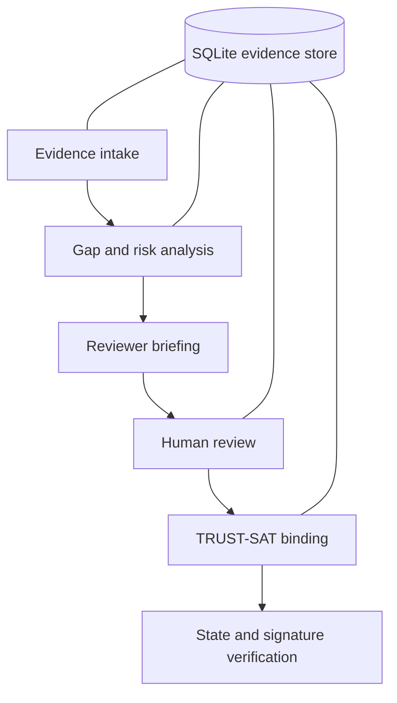

# Closure-Trace

**AI-assisted security review with evidence-backed, verifiable decisions.**

A closed alert does not establish that it was investigated, supported by evidence,
or escalated when needed. Closure-Trace analyzes submitted alert and case histories
for investigation gaps, premature closures and missed escalations. It ranks findings,
links them to source evidence and helps a human reviewer decide what happens next.

**Evidence → gap analysis → reviewer briefing → human decision → verifiable record.**

The optional language model explains computed findings; it does not set risk or
make decisions. Without a provider, the workbench presents a labelled deterministic
briefing. The TRUST-SAT integrity layer binds recorded results and review decisions
with SHA3-256 and ML-DSA-65. Verification detects changes to the bound state; it does
not establish that the underlying evidence is true or the reviewer is correct.

[Demo guide](docs/CLOSURE_TRACE_DEMO.md) · [Verification results](docs/CLOSURE_TRACE_READINESS.md) · [Documentation](docs/README.md)

## Capabilities

- Ingest CSV, JSON, JSONL and SQLite submissions containing alerts, cases,
  investigation steps, escalations, dispositions and assets.
- Detect fast closures, acknowledgement without investigation, missing escalation,
  repeated investigation, recurring incidents and coverage gaps.
- Review decomposable risk, evidence confidence, prioritized findings and source
  provenance. Risk and confidence describe different properties.
- Generate bounded recommendations and optional model-assisted reviewer briefings.
- Record human decisions with authorization, tenant isolation and an audit trail.
- Finalize and verify signed review artifacts using the existing TRUST-SAT ledger.

Closure-Trace is a periodic, evidence-driven review tool. It is not a SIEM, a SOC
replacement, a continuous monitoring service or an autonomous decision authority.

## Fresh clone quickstart

Requirements: Python 3.10 or newer (CI uses 3.11 and 3.13), Node.js 24 or newer, and npm. Installing dependencies requires internet access.

```bash
git clone https://github.com/PrathamKapoor/Closure-Trace.git
cd Closure-Trace
python -m venv .venv
# Windows PowerShell: .\.venv\Scripts\Activate.ps1
# Linux/macOS: source .venv/bin/activate
python -m pip install -r requirements.txt
python -m pip install -e . --no-deps
python scripts/local_stack.py --seed-demo
```

The local stack initializes SQLite, starts the API and analysis worker, and seeds synthetic demo data. Local data and generated login credentials live in ignored `.satsa-local/`; use your own generated credentials from that directory to sign in. No hosted deployment credentials or external model API keys are required for the default local demo.

In another terminal:

```bash
cd web
npm ci
# Linux/macOS:
SATSA_API_BASE_URL=http://127.0.0.1:8000 npm run dev
# Windows PowerShell instead:
# $env:SATSA_API_BASE_URL = "http://127.0.0.1:8000"
# npm run dev
```

Open http://localhost:3000. See [web setup](web/README.md), [API configuration](docs/API_CONTRACT.md), and [deployment setup](deploy/README.md). `.env.saas.example` and `deploy/production.env.example` contain placeholders for optional hosted infrastructure; supply your own values locally. Never commit populated environment files.

Optional model-assisted reviewer briefings use your own provider credentials; see [provider configuration and fallback](docs/LLM.md) and `.env.example`. Obtain NVIDIA credentials from your NVIDIA API account or OpenRouter credentials from your OpenRouter account. Bedrock uses your AWS role and enabled model access. Export these variables into the worker environment; the Python application does not automatically load `.env`. With no provider configured, briefings fall back to deterministic summaries.

Validation: `python -m pytest tests/ -q`; from `web/`, run `npm run check` for lint, type checking, and a production build. The hackathon submission also requires a separately published 2–4 minute demo video.

After building the frontend, rehearse the real workflow in an isolated temporary
database (including real signing, a risk-field mutation, rejection of the changed
state, restoration, and HTTP UI smoke checks):

```bash
python scripts/rehearse_closure_trace.py --web
```

This command generates disposable local keys, prints no credentials, and deletes
its temporary state after shutting down the API, worker and web server. It is a
technical rehearsal, not a browser interaction test. The submitted product's
verification API reports `VERIFIED`, `INCONSISTENT`, `NOT_FINALIZED` or `UNAVAILABLE`.

## Workflow and architecture



FastAPI exposes the authenticated application API. A local worker runs the analysis
workflow; Next.js provides intake, findings, evidence, review and verification pages.
The Python packages retain their source names: `satsa` contains supervisory analytics,
while `qsmlops` supplies shared orchestration, identity, storage and cryptography.

See the [system architecture](docs/SATSA_SYSTEM_ARCHITECTURE.md),
[API contract](docs/API_CONTRACT.md), [authorization matrix](docs/security/AUTHORIZATION_MATRIX.md)
and [trust model](docs/TRUST_MODEL.md) for the actual component boundaries.

## Repository structure

| Directory | Purpose |
|---|---|
| `satsa/` | Evidence ingestion, analytics, supervisory review and application API |
| `qsmlops/` | Shared platform, security, storage and orchestration |
| `web/` | Next.js workbench and public pages |
| `scripts/` | Local startup, bootstrap, seed, rehearsal and evaluation commands |
| `tests/` | Python regression, integration and security checks |
| `evaluation/`, `public_benchmarks/` | Controlled evaluation tools and dataset adapters |
| `docs/` | Setup, architecture, security, evaluation and engineering references |
| `deploy/` | Optional deployment configuration and runbooks |

## Testing and verification

With the virtual environment activated:

```bash
python -m pytest tests/ -q
python -m compileall -q satsa qsmlops scripts
python -m pip install bandit
python -m bandit -r satsa qsmlops scripts -lll -q
```

From `web/`:

```bash
npm run check
npx playwright install chromium
npm run test:e2e
```

The browser suite starts the existing test stack. Optional HTTP smoke tests require
a running frontend; see [web setup](web/README.md). Tests requiring PostgreSQL,
HSMs or external providers have explicit prerequisites and may skip locally.

The [verification snapshot](docs/CLOSURE_TRACE_READINESS.md) records the tested
configuration and actual results. Synthetic demonstrations and controlled integrity
experiments establish specific engineering behavior, not real-world detection accuracy.
Public dataset adapters do not imply that real datasets were downloaded or evaluated.

## Deployment and security

The default demo initializes its own SQLite database and generates local credentials
and signing keys. Runtime directories, populated environment files, private keys,
logs and local databases are ignored. Every developer supplies their own credentials;
configuration templates contain placeholders only.

Core analytics, signing and verification work locally once dependencies are installed.
Enabling an external model provider permits outbound provider requests. Production
hosting, TLS, persistence and operational controls require explicit configuration:
see the [deployment runbook](deploy/README.md) and [security review](docs/security/SECURITY_REVIEW.md).

## Limitations

- The demo uses synthetic records and is not a detection-accuracy benchmark.
- Optional live model providers are separately configured and require their own access.
- Cryptographic verification binds the documented state and decision, not real-world truth.
- The software post-quantum implementation and database/ledger/key trust boundary retain
  the limitations in the [trust model](docs/TRUST_MODEL.md).
- UI branding and the submission video remain separate presentation work; passing tests
  does not establish production readiness or complete the competition submission.

## Attribution and license

Closure-Trace is derived from the SAT-SA / TRUST-SAT foundation, originally developed
for supervisory security analytics. Existing implementation history, package names and
source attribution are preserved. It is not presented as independently written from scratch.

Licensed under [MIT](LICENSE), copyright © 2026 Pratham Kapoor.
